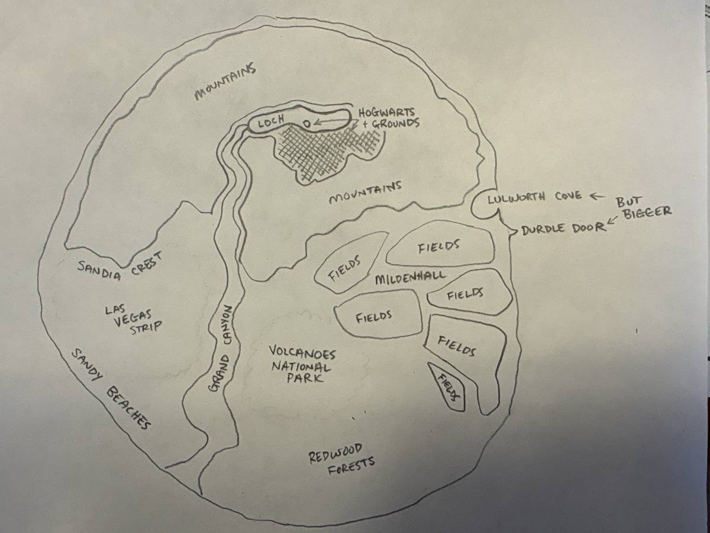

# The island

What the island is, as the owner designed it in conversation. Milestone 4 is planned from this file. Distances are nautical miles.

## The idea

One invented island, about 20 miles across, packed with places a pilot would know at a glance: some from Britain, some from the American West, one from Hawaii. Dense on purpose: at 500 knots each place is half a minute from the next.

At 500 knots, 10 miles takes 72 seconds, so coast to coast is under two and a half minutes. The owner first chose 40 miles and halved it on seeing the first pictures. The size is one number in the recipe (`SCALE` in `terrain/make-island.mjs`): it moves where things are, and the mountains, canyon and loch keep their real sizes.

The first island had three places: highlands, fields and a south coast of cliffs. On seeing it in the app, the owner drew the map below, and the island is being rebuilt to it.

## The map

The owner's own sketch. North is up.



```
                       N
            .-------------------.
          /    M O U N T A I N S  \
         /      [== loch ==]        \
        /   ,--'  castle + grounds   \
       |   /  viaduct                 ) cove
       |__/ ~|   M O U N T A I N S   /  door
  crest|     |~        ___----------|
       | the  |~      / fields   fields
       | Strip |~    |   AIR BASE  fields
        \      |~     \ fields  fields
  beaches\  canyon     volcanoes     |
          \    |~        park       /
           `-._|~_   redwoods  _.-'
```

## The places

**The mountains, across the north.** Scottish in shape and colour, but bigger than life: peaks of 6,000 to 8,000 feet, in an arc round the loch.

**The loch,** in the middle of the mountains, ringed by them. A river leaves its west end.

**The castle school and its grounds.** Inspired by and heavily influenced by Hogwarts: a millennial should know it at a glance. The castle stands on the loch's south shore, with its grounds running south from it. The whole place is hidden: it can't be seen from the lowlands, and a pilot finds it by flying up the canyon or over a ridge. In the grounds:

- **The forest,** dark and thick, along the grounds' edge.
- **The gamekeeper's hut,** at the edge of the forest.
- **The big willow,** standing alone and proud in an open field near the castle.
- **Practice pitches,** and **the stadium:** an oval with tall goal hoops at each end and towers round it.

What makes the castle read at a glance, from the owner's reference model (a very detailed voxel castle he shared from his Drive; a guide to the idea, not something to copy or match in detail):

- A dense cluster of dark stone towers of different heights, each with a tall, steep, pointed roof. The skyline of spires is the whole recognition.
- One tower clearly the tallest, off-centre.
- A long great hall with a steep pitched roof and tall windows, against the cluster.
- A long covered bridge on tall legs, crossing a ravine to the castle.
- A glass-domed greenhouse and a small courtyard.
- Outlying pieces: a lone tower on its own rock, a boathouse down at the loch.

Ours is far simpler: plain shapes, dark grey stone and near-black roofs, a few thousand triangles. Get the skyline right and leave the rest out.

**The viaduct.** A long, curved stone railway viaduct on tall arches: the giant bridge from the films. It spans the upper canyon just below the loch, with the river running under it, and it is solid, so a canyon run goes through its arches. The steam train on it is saved for later, in the Ideas doc.

**The canyon.** The river from the loch runs south down the island to the south-west coast through a canyon inspired by the Grand Canyon, cut into a high desert plateau. It is built to be fun to fly through: deep enough to be below the rim the whole way, wide enough to follow at speed, winding, with a tight stretch as a dare. The starting figures are about 3,000 feet deep, three-quarters of a mile wide at the rim and a quarter mile at the river, and about 12 miles long; they are tuned by flying it.

**The crest.** Where the mountains stop above the desert in the west: a long, steep wall a few thousand feet high, after Sandia Crest near Albuquerque and Moriarty, New Mexico, famous for sailplane flying. Shaped as a proper ridge, so that if a glider and rising air are ever added, this is the place for them. That is an idea for later, not part of this build.

**The Strip.** On the desert below the crest, west of the canyon: the Las Vegas Strip and nothing else of the city. About a mile and a half of big hotels along one road. The recognizable ones are all there: a pyramid, a tall needle tower, a big wheel, a lake with fountains, an Eiffel Tower, an Arc de Triomphe, a Montgolfier balloon, and a casino that looks like Camelot. Plain slab hotels fill in between. The shapes are the famous ones; every name and sign is invented. Daytime only: the game has no night. No runway there.

**The beaches.** Sandy beaches along the south-west coast.

**The volcanoes park,** in the centre-south, after Hawaii's. One broad volcano about 4,000 feet high, with a crater to fly into and a glowing lava lake at the bottom, a few small cones beside it, and black lava fields running down to the south coast. No eruptions, smoke or ash for now.

**The redwoods,** in the south. A forest of giant trees about 300 feet tall, to fly over. It has to look like a forest made of trees, not a green block.

**The fields, in the east.** Flat East Anglian farmland: a patchwork of four-sided fields, with tracks between them and lines of trees.

**The air base.** In the fields. Modelled on RAF Mildenhall: it doesn't have to be perfect, but a pilot should look at it and recognize Mildenhall. One runway, 10/28, 9,200 by 150 feet, with Mildenhall's layout of taxiways, ramp, hangars and tower. It is the only place to land, and every flight starts on its runway.

**The cove and the Door, on the east coast.** Lulworth Cove, but bigger: about a mile across behind a mouth a quarter mile wide, with cliffs round it, so a jet can fly in through the mouth, turn hard round the bay and fly back out. Durdle Door stands just south of it, with an opening to fly through.

## How it looks

Painted, to match the jet: clean, flat colours on flat-shaded land. Not photographic. Each kind of country has its own paint: green hills and grey rock in the mountains, a patchwork in the fields, red and tan rock in the desert and the canyon, black lava in the park, deep green in the redwoods, pale sand on the beaches, white chalk at the cove.

**Woods must look like trees.** The first woods in the app were plain dark green blocks, and the owner's verdict was that they were green blobs. Every wood and forest has to read as a forest made of trees, from above and from the side.

## Scale

Everything is real size, 1 to 1: the person who fits the F-4's cockpit can walk through a door in the castle. Three things are bigger than life on purpose:

- **The mountains,** as above.
- **The viaduct's arches,** so an F-4 can blast through one: each opening at least 115 feet wide and 130 feet tall, three times the jet's 38-foot wingspan. The real ones are about 50 feet wide.
- **The opening in Durdle Door,** the same size at least, for the same reason.
- **The cove,** about four times the real one's width, so a jet can turn inside it.

## What is solid

With crashes on (the crash override off):

- **Land** behaves as the runway does today: a hard hit ends the flight, a scrape survives.
- **Buildings and landmarks** are solid: the castle, the stadium, the viaduct, the hotels and towers of the Strip, the hangars and tower, the arch at Durdle Door. Flying through an arch is a real dare.
- **Woods and forests** are solid at treetop height, as one block: 40 feet for ordinary woods, about 300 for the redwoods. Lone trees and hedgerow trees are scenery.
- **Water** ends the flight at any touch, however gentle: the sea, the loch and the river. To be revisited if an amphibious airplane joins the hangar.
- **Lava** ends the flight at any touch, like water.

With the crash override on, nothing ends a flight, as now.

## Not decided yet

- Names. The island and its places have none of their own yet.
- Nothing in the app shows a place's name. The real places above are the inspiration; brands, casinos and signs are invented.

## Who builds what

- **The land,** its paint, the water, the lava, the woods and forests, roads and plain block buildings: the app, from the map in `terrain/`.
- **Everything recognizable** is a Blender model, built in a model chat like the airplanes: the castle, the stadium, the hut and the willow; the viaduct; Durdle Door; and each landmark of the Strip.

## The order it is built in

The land for the whole island first; then the canyon and viaduct; the castle and grounds; the volcano; the Strip; the redwoods. The air base's layout whenever the owner sends a picture of Mildenhall.

## Woods and trees, as built so far

- **Woods** are part of the map: `terrain/island.png` carries the treetops' height over each post (its blue channel), so the flight model and the picture both treat a wood as ground that stands 40 feet taller. In the farmland a wood is one whole plot; elsewhere woods grow in patches on low, gentle ground. None on the airfield or off the runway's ends, and none in the glens.
- **Scenery trees** stand beside the tracks between the fields, drawn only near the camera. Where they stand is worked out from the place itself (`src/fields.js`), so they are the same every visit.
- The farmland's plots are worked out twice, in `src/fields.js` and in the paint in `src/render/terrain.js`, by the same arithmetic, so the woods and trees stand in the plots that are painted.

## Where it is kept

The island's map is three files in `terrain/`, all written by `terrain/make-island.mjs`; to change the island, change that script and run it.

- `island.png`: the land's height (red and green), and what stands on it (blue: the treetops' height, or the river's mark).
- `country.png`: what kind of country each place is: desert, lava or farmland; the rest is green.
- `island.json`: where the map lies, the loch and the lava lake, the river's course, and where each landmark stands.

`node terrain/preview.mjs <folder>` draws pictures of the result. `tests/island.test.js` checks the land against this page, and flies it.
